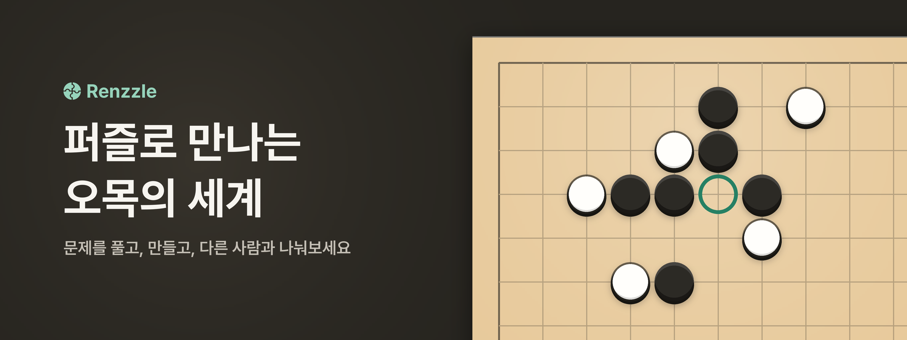
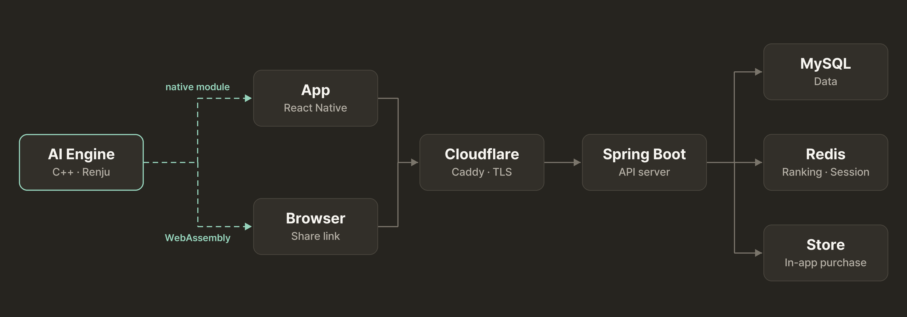

  
  

## Service

Renzzle은 전문 오목 퍼즐 앱입니다.\
주어진 국면에서 자체 AI 엔진의 방어를 뚫고 이기는 수순을 찾습니다.\
초보자부터 고수까지 자기 수준에 맞는 문제로 수읽기를 연습할 수 있습니다.

- **트레이닝** · 오목 기사가 직접 출제한 문제를 난이도별 문제집으로 풉니다.
- **커뮤니티** · 유저 간에 직접 문제를 출제하여 공유합니다. 자체 엔진이 문제를 검증하고 정답 수순을 생성합니다.
- **랭킹전** · 레이팅에 맞는 문제를 연달아 풀며 순위를 겨루는 모드로, 문제 풀이에 경쟁하는 재미를 더합니다.

## Project

- **기간** · 2024.04 ~ 운영 중
- **팀** · 4명
- **범위** · iOS·Android 앱, API 서버, C++ AI 엔진

## What We Built

### AI Engine

C++ Renju AI. 사용자의 수에 대응하고, 사용자가 만든 문제의 풀이를 검증

- **탐색** · Alpha-Beta + PVS, Iterative Deepening으로 제한 시간 안에서 탐색 깊이 결정
- **국면 캐시** · Transposition Table + Zobrist Hashing으로 중복 국면 재계산 방지
- **평가** · 열린 3·닫힌 4 등 돌 패턴 기반 평가 함수, 후보 수 생성과 정렬
- **룰** · Renju 금수 판정 (흑 3-3, 4-4, 장목)
- **멀티 플랫폼** · 같은 코드를 앱 네이티브 모듈과 WebAssembly로 빌드

### App

React Native 앱 (iOS · Android). Zustand, React Navigation

- **네이티브 엔진 연동** · C++ 엔진을 JNI(Android) · Objective-C++(iOS) 모듈로 연결
- **AI 응답 캐시** · 서버에 쌓인 풀이 트리 → 국면별 캐시 → 기기 내 계산 순으로 응답을 찾고, 기기에서 계산한 결과는 서버 캐시에 다시 저장
- **딥링크 진입** · 공유 링크가 로그인 전이나 랭킹전 도중에 들어오면 대기했다가 끝난 뒤 해당 문제로 이동
- **운영 화면** · 문제 검수, 문제집, 공지, 결제 · 환불 관리를 앱 안에 권한별로 제공

### Server

Spring Boot API 서버와 공유 링크 웹 페이지

- **랭킹전** · 행 잠금과 멱등 처리로 재전송된 결과도 한 번만 반영, 레이팅에 맞는 문제 출제, Redis Sorted Set 순위
- **결제** · Google Play · App Store 구매 서버 검증, 스토어 환불을 반영해 지급 회수
- **AI 풀이 캐시** · 문제별 풀이 트리를 저장해 앱과 웹이 같은 국면을 다시 계산하지 않도록 공유
- **공유 링크** · 브라우저에서 바로 푸는 웹 페이지 (WebAssembly 엔진), 앱 설치 시 Universal Links · App Links로 앱 실행

### Infra

- OCI(Oracle Cloud) + Docker Compose, Cloudflare + Caddy(TLS)
- PR마다 Testcontainers(MySQL · Redis) 기반 통합 테스트 실행 (GitHub Actions)
- PR 댓글로 테스트 서버 · 운영 서버 배포
- Promtail · Loki 로그, Prometheus 메트릭 수집

## Architecture

