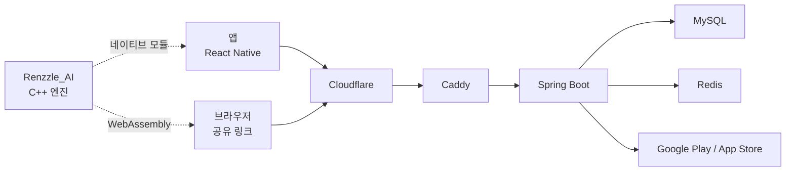

  
  

## Service

Renzzle은 오목 퍼즐 앱입니다. 주어진 국면에서 AI의 방어를 뚫고 이기는 수순을 찾습니다. 초보자부터 고수까지 자기 수준에 맞는 문제로 수읽기를 연습할 수 있습니다.

- **트레이닝** · 난이도별로 정리된 문제집을 차례로 풀며 실력을 다집니다.
- **커뮤니티** · 직접 문제를 만들어 공유하고, 다른 사용자의 문제를 풀고 평가합니다. AI 검증을 통과한 문제에는 인증 표시가 붙습니다.
- **랭킹전** · 트레이닝 문제와 인증된 커뮤니티 문제 중 내 레이팅에 맞는 문제가 이어서 나오고, 결과에 따라 레이팅이 오르내립니다.

## Projects

### Backend

`Renzzle_BE` · API 서버와 공유 링크 웹 페이지

- Google Play · App Store 인앱 결제 서버 검증, 스토어 환불 반영
- 랭킹전 결과가 중복 전송돼도 한 번만 반영
- 공유 링크 페이지 서버 렌더링, iOS · Android 딥링크
- PR 댓글로 테스트 · 운영 서버 배포

### Frontend

`Renzzle_FE` · iOS · Android 앱

- C++ AI 엔진을 네이티브 모듈로 탑재해 기기 안에서 수읽기
- 인앱 결제, 광고, 7개 언어
- 운영 화면 앱 내장 (문제 검수, 공지, 결제 내역)

### AI

`Renzzle_AI` · C++ 렌주 AI 엔진

- Alpha-Beta 탐색, PVS, Iterative Deepening
- Transposition Table, Zobrist Hashing
- VCF 전용 탐색, 렌주 금수 판정
- 앱에는 네이티브로, 웹에는 WebAssembly로 같은 엔진 사용

## Architecture

